<div align="center">
  <picture>
    <source media="(prefers-color-scheme: dark)" srcset="assets/hero-dark.svg">
    
  </picture>
  <picture>
    <source media="(prefers-color-scheme: dark)" srcset="assets/ticker-dark.svg">
    
  </picture>
</div>

## 안녕하세요, 박세준입니다

경북대학교 전자공학부에서 회로와 펌웨어를 배웠고,\
빗물받이 청소 로봇 **쓰리봇**을 공동창업해 PM을 맡으며\
STM32 펌웨어부터 ROS2 비전, 관제 웹까지 한 시스템으로 묶었습니다.

일할 때 지키는 원칙은 세 가지입니다.

- **구조부터 그립니다.** 바뀔 부분은 어댑터로 떼어 두고, 분기가 늘어날 로직은 상태(FSM)로 짭니다.
- **검증 기준을 먼저 세웁니다.** 자동화한 결과는 기준을 통과할 때만 믿습니다.
- **기록하고 번역합니다.** 증상 → 원인 → 확인 → 조치 순서로 남기고, 같은 기술도 듣는 사람에 맞춰 다르게 설명합니다.

> 문제를 어떻게 풀었는지는 [포트폴리오 사이트](https://my-project-one-sigma-74.vercel.app)에,\
> 만들면서 쓴 회고는 [기술 블로그](https://blog-1vld.vercel.app)에 정리해 두었습니다.

<div align="center">

[](https://my-project-one-sigma-74.vercel.app)
[](https://blog-1vld.vercel.app)
[](mailto:mnunu1234@naver.com)

</div>

---

<picture>
  <source media="(prefers-color-scheme: dark)" srcset="assets/sec-awards-dark.svg">
  
</picture>

<div align="center">
  <picture>
    <source media="(prefers-color-scheme: dark)" srcset="assets/awards-dark.svg">
    
  </picture>
</div>

<details>
<summary><b>수상 13건 전체 보기</b></summary>

| 시기 | 결과 | 대회 · 주최 |
|---|---|---|
| 2026.10 | **대상** | 판타지아 대구 AI 페스타 카드뉴스 부문 |
| 2026.05 | **최우수** | AI 활용 대학생 로컬임팩트 포럼 발표 부문 · 사단법인 루트임팩트 |
| 2025.12 | **최우수** | KNU-UP 학생 창업아이템 시제품 제작 경진대회 · 경북대 지산학연협력기술연구소 |
| 2025.11 | **최우수** | 2025 기후테크 아이디어 경진대회 · 지식재산전문인력양성사업단 |
| 2025.11 | 우수 | 2025 미래한국 아이디어 공모전 · 기획재정부 |
| 2025.11 | 우수 | 2025 창업 경진대회 · 안동형일자리사업단 |
| 2025.11 | 은상 | 제5회 SDGs 소셜벤처 챔피언십 |
| 2025.11 | 장려 | 캡스톤디자인 온라인 경진대회 · 한국환경기술학회 |
| 2025.11 | 장려 | 2025 CBC KOREA 창업경진대회 |
| 2025.10 | 우수 | 한국정보시스템학회 추계학술대회 ICT 지식재산 아이디어 경진대회 |
| 2025.10 | **대상** | 한국도로공사 56주년 AI영상 제작 공모전 |
| 2025.09 | **최우수** | KNU-E 창업역량 강화캠프 · 경북대 산학협력단 |
|  | 우수 | 일맥 아이디어톤 |

</details>

---

<picture>
  <source media="(prefers-color-scheme: dark)" srcset="assets/sec-layers-dark.svg">
  
</picture>

<div align="center">
  <picture>
    <source media="(prefers-color-scheme: dark)" srcset="assets/layers-dark.svg">
    
  </picture>
</div>

> 점 하나는 그 프로젝트에서 제가 맡은 레이어입니다. 쓰리봇에서는 다섯 레이어를 모두 거쳤습니다.

| 레이어 | 직접 해본 일 | 프로젝트 |
|---|---|---|
| **L5** Service | 관제 지도 UI, 에이전트 파이프라인, LLM 추출 + 규칙 검사, 음성 면접 흐름 | 쓰리봇 · 에이전트 · 할증레이더 · 면접로봇 · 안전알림 |
| **L4** Data | FastAPI · PostgreSQL, 공간 인덱스, IsolationForest + 로지스틱 회귀, walk-forward 검증 | 쓰리봇 · KAMP · 할증레이더 · 에이전트 · 면접로봇 |
| **L3** Vision | ROS2 + ZED Mini 3대, YOLOv8-seg 자동 라벨링, 깊이 차분 부피 계산, 관절 각도 제스처 | 쓰리봇 · 무드등 · 안전알림 |
| **L2** Firmware | STM32 이벤트 기반 FSM + 5계층, ACK / DONE 분리, ESP32 BLE 메시지, 서보 표정 13종 | 쓰리봇 · PV5 · 면접로봇 · 무드등 |
| **L1** Hardware | 24V 릴레이 · 윈치 전장, 노이즈 · 돌입전류 대책, LED 하네스, ZYXCAD 도면 6장 | 쓰리봇 · DRAIN-X · PV5 |

---

<picture>
  <source media="(prefers-color-scheme: dark)" srcset="assets/sec-projects-dark.svg">
  
</picture>

<div align="center">
  <picture>
    <source media="(prefers-color-scheme: dark)" srcset="assets/projects-dark.svg">
    
  </picture>
</div>

| 프로젝트 | 한 줄 소개 | 맡은 일 | 링크 |
|---|---|---|---|
| **[쓰리봇](#쓰리봇--빗물받이-청소-로봇과-관제-플랫폼)** | 빗물받이 청소 로봇 + 관제 플랫폼 (예창패 우수기업) | Co-founder · PM | [사례](https://my-project-one-sigma-74.vercel.app/project/threebot) · [펌웨어](https://github.com/mnunu123/Threebot_firmware) · [ROS2](https://github.com/mnunu123/nova_three_bot_ws) · [관제 웹](https://github.com/mnunu123/threebot-website) |
| **[DRAIN-X](#drain-x--2035-자율-빗물받이-준설-로봇-설계)** | 보도에 선 채 일하는 준설 로봇 도면 설계 | 1인 · 기구 설계 · 도면 | [사례](https://my-project-one-sigma-74.vercel.app/project/drainx) |
| **[AI 자동화 파이프라인](#ai-자동화-파이프라인--반복-작업을-구조로)** | 상세페이지 · A/B 판정 · PPT · 쇼츠 수집 · 영상 | 1인 · 설계 · 구현 | [사례](https://my-project-one-sigma-74.vercel.app/project/agents) · [ppt-agent](https://github.com/mnunu123/ppt-agent) · [detail-page](https://github.com/mnunu123/detail-page) |
| **[KAMP 검사 우선순위](#kamp-검사-우선순위--사출성형-제조-데이터)** | 불량확률 순위로 검사 자원을 나누는 모델 | 팀 · 모델 · 검증 설계 | [사례](https://my-project-one-sigma-74.vercel.app/project/kamp) |
| **[할증레이더](#할증레이더--선사-할증-공지를-읽는-llm--규칙-검사)** | 할증 공지 LLM 추출 + 원문 근거 대조 | 1인 | [데모](https://dx-eight-iota.vercel.app) · [사례](https://my-project-one-sigma-74.vercel.app/project/radar) · [GitHub](https://github.com/mnunu123/dx) |
| **[면접훈련 로봇](#면접훈련-로봇--inmoov-i2head를-ai-인터페이스로)** | InMoov 얼굴 서보로 만든 AI 면접관 | 서보 · 음성 · AI 연동 · 통합 | [사례](https://my-project-one-sigma-74.vercel.app/project/inmoov) |

---

## 쓰리봇 | 빗물받이 청소 로봇과 관제 플랫폼

> 노바로보틱스 공동창업 · 딥테크 예비창업패키지 **우수기업** · 2025.09 ~ 2026.02\
> _빗물받이 막힘은 민원이 들어오기 전에 먼저 알아야 했습니다_

현장 청소 · 데이터 수집 로봇, 관제 웹 플랫폼(Drain Sight), 위험도 예측 AI를 한 흐름으로 묶었습니다.

<details>
<summary><b>자세히 보기</b></summary>

### 구성

```
Jetson Orin (ROS2) ── UART ──▶ STM32F407 (FSM)
  ZED Mini ×3                    스테퍼 4축 · 윈치 · 실린더 · 서보 걸쇠

앱 현장 사진 · GPS ──▶ 클라우드 DB (NCP · PostgreSQL, "분석 대기")
                            │
                            ▼
              로컬 GPU 서버 — 위험도 · 청소 동선 · 침수 히트맵
                            │
                            ▼
                 관제 웹 (Next.js · 네이버 지도 · deck.gl)
```

### 문제와 판단

- **라벨링 360시간 → 18시간** — 사진 1장에 구멍이 60개가 넘었습니다. 원본 364장만 손으로 라벨링하고, 1차 모델과 Mobile-SAM이 나머지 마스크를 먼저 그리게 한 뒤 사람은 오검출만 고쳤습니다. 데이터셋 10,000장 이상, 구멍 인스턴스 분할 mAP@50 87.3%.
- **펌웨어 재설계** — main.c 한 파일에 몰린 로직을 이벤트 기반 FSM과 5계층(main → app → services → drivers → bsp)으로 나눴습니다. HOME 동작 중에는 WINCH 명령을 NACK로 거절해 충돌을 상태 전이 규칙에서 막고, 수락(ACK/NACK)과 완료(DONE/FAIL)를 따로 보냅니다. 새 명령은 `app_cmd.c`만 고치면 됩니다.
- **릴레이 노이즈 오동작 100% → 0%** — 역기전력 → 배선 → 소프트웨어 순서로 원인을 좁혔습니다. 하드웨어 대책 4가지(페라이트 코어, 전원선 트위스트, 바이패스 커패시터, 신호선 분리 배선)와 소프트웨어 대책 2가지(디바운스 20ms, CLOSE 입력 800ms 마스킹)를 넣고 100회 반복 시험에서 오동작 0건을 확인했습니다.
- **돌입전류 리셋** — 윈치 시동 순간 전압이 2.7V 아래로 떨어져 MCU가 리셋됐습니다. MCU와 모터 전원 분리, 대용량 커패시터, PWM 소프트스타트, MOSFET 스위칭으로 대책을 설계했습니다.
- **공공기관 보안 구조** — 국내 클라우드(NCP) + ACG 방화벽, DB 컨테이너는 127.0.0.1에만 바인딩, 접근은 API 서버 경유만 허용했습니다. 전용 계정에는 필요한 테이블의 CRUD만 주고 DROP · TRUNCATE는 막았습니다.
- **사업 운영** — 정부지원금 6,100만 원 과제의 제출 서류 · 정산 · 발주 · IR 피칭을 맡았습니다. 같은 기술을 기술형 · 창업형 · 사회문제형 대회에 맞춰 다르게 설명해 9개 대회에서 수상했고, 발표는 직접 했습니다.

### Tech Stack

STM32F407 · C/HAL · ROS2 Humble · Jetson Orin · ZED Mini · YOLOv8-seg · Mobile-SAM · FastAPI · asyncpg · PostgreSQL 15 · Next.js · 네이버 지도 · deck.gl · Docker · NCP

**GitHub** · [Threebot_firmware](https://github.com/mnunu123/Threebot_firmware) · [nova_three_bot_ws](https://github.com/mnunu123/nova_three_bot_ws) · [threebot-website](https://github.com/mnunu123/threebot-website) · [threebot_weight](https://github.com/mnunu123/threebot_weight)\
**포트폴리오** · [쓰리봇 사례 전체](https://my-project-one-sigma-74.vercel.app/project/threebot)

</details>

---

## DRAIN-X | 2035 자율 빗물받이 준설 로봇 설계

> 2026 제2회 ZYXCAD AX 경진대회 설계 부문 출품 · 1인\
> _차로를 막지 않고, 덮개부터 바닥 토사까지_

쓰리봇 MVP에서 부딪힌 문제를 그대로 설계 요구사항으로 바꾼, 보도를 주행하는 준설 로봇 도면입니다.

<details>
<summary><b>자세히 보기</b></summary>

### 쓰리봇에서 넘어온 요구사항

| 쓰리봇 MVP에서 부딪힌 벽 | DRAIN-X의 답 |
|---|---|
| 사람이 밀어서 정렬, 작업자가 도로 위에 섬 | 보도 자율 주행 + 차도 쪽 측면 650mm 리치 |
| 그리퍼를 덮개 구멍에 ±5mm로 넣어야 해서 VLA 모델까지 필요 | EPM(영구 전자석) 패드, 덮개 면에만 닿으면 됨 |
| 릴레이 노이즈로 윈치 오동작, 하강을 시간으로만 판단 | 엔코더 액추에이터 + 로드셀 접지 감지 |
| 물까지 빨면 무거워져 건식만 흡입 | 배수 구멍이 있는 클램셸로 바닥 토사까지 |

### 설계 판단

- **평행 4절 링크를 쓰지 않았습니다.** 덮개 플리퍼의 162° 스윙이 링크의 사점을 지납니다. 피벗 스프로킷과 암 끝 스프로킷을 1:1 체인으로 묶어 패드를 수평으로 유지했습니다.
- **150mm 수직 상승부터 합니다.** 덮개가 프레임에 30mm 묻혀 있어서 바로 원호로 돌리면 턱에 걸립니다.
- **정전에도 덮개가 떨어지지 않습니다.** EPM은 전원 없이 유지되고, 피벗은 스스로 잠기는 웜 감속입니다.
- **전도 안정성은 차도 쪽으로 계산했습니다.** 굴착 중에는 아웃리거를 펴야만 동작하도록 인터록을 걸고, Z 인장을 600N으로 제한했습니다.

### 도면

DWG 파일 하나에 배치 탭 S01~S06 — 일반 배치도(1:20) · 조립도와 부품표(1:10) · 덮개 플리퍼(1:5) · 작업 단면(1:20) · 클램셸과 커플러(1:5, 1:2) · 부품도. 링크 궤적과 최소 여유는 Python으로 계산하고, AutoLISP로 CAD 안에서 다시 검사했습니다.

### Tech Stack

ZYXCAD AX · AutoLISP · Python (링크 궤적 · 전도 안정성 · 질량 계산) · 3각법 1:20 / 1:10 / 1:5 / 1:2

**포트폴리오** · [DRAIN-X 사례 전체](https://my-project-one-sigma-74.vercel.app/project/drainx)

</details>

---

## AI 자동화 파이프라인 | 반복 작업을 구조로

> 1인 · 2025.11 ~ 2026.04\
> _AI 도구를 써 본 것이 아니라, 반복 작업을 자동화 구조로 바꿨습니다_

에이전트 하나에 모든 판단을 몰지 않고 파이프라인으로 쪼갭니다. 중간 산출물은 JSON으로 남겨 단계별로 다시 돌리고, 선택 이유를 데이터에 함께 기록합니다.

<details>
<summary><b>자세히 보기</b></summary>

| 파이프라인 | 하는 일 | 저장소 |
|---|---|---|
| 상세페이지 | 정보수집 → 리서치 → 카피 13섹션 → 디자인 → 이미지 프롬프트 → Gemini 이미지. 입력 후 3~5분에 1200×7000px | [landing-page-generator](https://github.com/mnunu123/landing-page-generator) |
| A/B 판정 | GA4 3단계 이벤트 추적. 표본 · 노출 · SRM · CVR 차이 기준을 모두 통과할 때만 승자 선언 | [detail-page](https://github.com/mnunu123/detail-page) |
| 설득형 PPT | 명령 하나로 PPTX · 스토리보드 · 검증 리포트. 설득 규칙 R0~R7을 기계가 검수 | [ppt-agent](https://github.com/mnunu123/ppt-agent) |
| 쇼츠 수집 | 키워드 → 번역 → 도우인 검색 → 가중 랭킹 → 다운로드. 선택 이유를 JSON으로 기록 | [auto-rank](https://github.com/mnunu123/auto-rank) |
| 코드 영상 | Remotion 1920×1080 30fps. 씬 타이밍과 TTS 파일명을 1:1로 묶어 싱크 어긋남 예방 | [remotion-intro-video](https://github.com/mnunu123/remotion-intro-video) |
| 포트폴리오 메이커 | 회사 무드 5종 랜딩. 302 리다이렉트를 실패로 보던 문의 폼을 서버 라우트로 수정 | [portfolio_website](https://github.com/mnunu123/portfolio_website) |

### 판단 기록

- 단일 프롬프트로 전체를 만들게 하면 일관성과 길이가 제멋대로였습니다. 역할을 나누고, 쉬운 단계는 Haiku, 품질이 중요한 단계는 Sonnet을 씁니다.
- AI가 이미지 안에 그린 "지금 신청하기" 버튼은 그림이라 클릭이 안 됩니다. 이미지는 그대로 두고 % 좌표 기반 CTA 버튼을 위에 얹었습니다. 생성은 AI에게, 인터랙션은 별도 레이어에서.
- 조회수만 보면 광고성 영상이 위로 올라옵니다. 좋아요 ×3 · 댓글 ×5 · 공유 ×2 · 조회 ×1로 반응에 가중치를 뒀습니다.

**포트폴리오** · [AI 자동화 사례 전체](https://my-project-one-sigma-74.vercel.app/project/agents)

</details>

---

## KAMP 검사 우선순위 | 사출성형 제조 데이터

> 2026 제6회 K-인공지능 제조데이터 분석 경진대회 · 팀\
> _"불량을 맞히지 말고, 검사 순서를 정하자"_

불량률 0.96%인 사출성형 라인에서, 부품별 불량확률 순위로 정밀 · 표준 · 샘플링 검사를 나눠 배분하는 모델입니다.

<details>
<summary><b>자세히 보기</b></summary>

### 문제를 다시 정의했습니다

불량이 1% 미만이면 검사 시간 대부분이 양품 확인에 쓰입니다. 그래서 목표를 "불량 판별"이 아니라 "부품별 불량확률 순위로 검사 자원을 나누는 것"으로 다시 잡았습니다. 평가 지표도 정확도 대신 같은 검사량에서 잡아낸 불량 수로 바꿨습니다. 전부 양품이라고 찍어도 정확도는 99.1%가 나오지만, 불량은 하나도 못 잡기 때문입니다.

### 근거 세 가지를 합쳤습니다

1. **공정 이상 점수** — IsolationForest를 양품 위주의 "평소 상태"로만 학습
2. **캐비티 위험도** — 제품 × 금형 자리별 과거 불량률의 베이지안 평균
3. **연속불량 상태** — 직전 5샷의 불량 수와 감쇠 점수

세 근거를 로지스틱 회귀로 합쳤고, 날짜는 누수를 막으려고 입력에서 뺐습니다.

### 날짜순으로 검증했습니다

생산일마다 그 이전 데이터로만 표준화 · 학습 · 기준값을 다시 만드는 walk-forward 방식입니다. 10월 데이터에서 검사량 60.3%로 불량 25건을 모두 잡았습니다. 결과 파일은 SEED 42로 3개 환경에서 동일하게 재현됩니다.

### Tech Stack

pandas · numpy · scikit-learn · IsolationForest · Logistic Regression · LightGBM(비교) · matplotlib

**포트폴리오** · [KAMP 사례 전체](https://my-project-one-sigma-74.vercel.app/project/kamp)

</details>

---

## 할증레이더 | 선사 할증 공지를 읽는 LLM + 규칙 검사

> 2026 해운·항만·물류 AX 혁신 아이디어 공모전 출품 · 1인\
> _근거 구절이 원문과 일치할 때만 자동 반영합니다_

선사가 수시로 올리는 할증료 공지를 표로 정리하고, 숫자마다 원문 근거를 붙여 화물 1건에 붙는 할증 합계를 계산합니다.

<details>
<summary><b>자세히 보기</b></summary>

### 구조 — AI가 판단하는 단계는 하나

```
① 공지 수집     원문 · URL · 수집 시각 · 해시
② LLM 추출      24칸 레코드, 근거 구절은 원문 그대로
③ 규칙 검사     근거 원문 일치 · 금액 · 시작일 · 약어 · 지역 → 자동 승인 / 사람 확인
④ 할증 DB
⑤ 계산 엔진     기준일 · 최신 공지 대체 · 범위 판단 (손계산 테스트 16건 통과)
```

### 평가

정답셋 45건을 직접 만들고 test 레코드 294개를 원문과 전수 대조했습니다. 같은 잣대로 비교한 추출기 3종 중 Sonnet이 280개(95.2%)로, 정규식(8개)과 소형 모델(195개)보다 높았습니다.

### Tech Stack

Claude Sonnet · Claude Haiku · Python · 해수부 화물운임공표 API · HTML 프로토타입(Vercel)

**데모** · [dx-eight-iota.vercel.app](https://dx-eight-iota.vercel.app)\
**GitHub** · [dx](https://github.com/mnunu123/dx) · **포트폴리오** · [할증레이더 사례 전체](https://my-project-one-sigma-74.vercel.app/project/radar)

</details>

---

## 면접훈련 로봇 | InMoov i2Head를 AI 인터페이스로

> 한이음 ICT 프로젝트 · 2026.02 ~ 2026.11 · 서보 얼굴 구동 · 음성 인터랙션 · AI 연동 · 통합\
> _"로봇처럼 보이는 것"보다 "면접관처럼 느껴지는 것"_

오픈소스 휴머노이드 InMoov의 얼굴(서보 17개)을 AI 면접관 인터페이스로 바꾸는 프로젝트입니다.

<details>
<summary><b>자세히 보기</b></summary>

- 전신을 다 만들지 않고 눈(시선) · 턱(발화 동기화) · 목(끄덕임) · 눈썹(감정) 네 부위만 골랐습니다. 면접관 느낌에는 움직임의 정밀도보다 타이밍과 시선이 중요하다고 봤습니다.
- 실시간 서보 제어 대신 상태별 프리셋 모션(`listen_pose`, `nod_small`, `thinking_pose`)을 실행합니다. 프리셋 표정은 13종입니다.
- AI 서버(STT → LLM → TTS → 평가)와 로봇 컨트롤러를 Bridge API로 나눠, 로봇 없이도 텍스트로 먼저 검증했습니다. 텍스트 면접 → 음성 → 실물 로봇 연결 순서로, 위험이 큰 하드웨어 조립을 마지막에 뒀습니다.
- 로봇 연결 전 단계로 OPIc 음성 모의면접 웹 MVP를 혼자 만들었습니다. 질문 생성 → 음성 답변 → STT → 분석 → 피드백 → PDF 리포트까지 이어집니다.

### Tech Stack

InMoov i2Head · Arduino Mega · PCA9685 · Python · FastAPI · Whisper STT · Claude API · TTS · ReportLab

**포트폴리오** · [면접훈련 로봇 사례 전체](https://my-project-one-sigma-74.vercel.app/project/inmoov)

</details>

---

<picture>
  <source media="(prefers-color-scheme: dark)" srcset="assets/sec-more-dark.svg">
  
</picture>

<details>
<summary><b>안전 알림이 | 안전보호구 착용 모니터링</b></summary>

2024 스마트 해상물류 ICT 멘토링, 4인 팀. 카메라 기반 착용 인식 · 경고 로직 · UI · 정확도 개선을 맡았습니다.

- 데이터셋 2,548장, 검증셋 Precision 0.932 · Recall 0.912, 추론 1.9ms (RTX A6000)
- Raspberry Pi 4B와 TCP 소켓, Flask · SQLite, 카카오톡 알림과 PDF 리포트

`stack` YOLOv8 · Roboflow · Flask · SQLite · Raspberry Pi 4B

**포트폴리오** · [안전 알림이](https://my-project-one-sigma-74.vercel.app/project/helmet)

</details>

<details>
<summary><b>스마트 무드등 | 관절 각도로 읽는 손동작 5종</b></summary>

웹캠으로 손동작 5종(red · green · blue · up · down)을 인식해 무드등의 색과 밝기를 바꿉니다. 손 위치와 크기에 흔들리지 않도록 좌표 대신 관절 각도 15개를 특징으로 썼습니다.

- 시퀀스 샘플 4,010개(30프레임 × 99차원), Transformer 분류
- ESP32(FreeRTOS · MQTT · BLE) 연동

`stack` MediaPipe Hands · OpenCV · TensorFlow/Keras · ESP32

**GitHub** · [-Smart-mood-light](https://github.com/mnunu123/-Smart-mood-light) · **포트폴리오** · [스마트 무드등](https://my-project-one-sigma-74.vercel.app/project/moodlight)

</details>

<details>
<summary><b>로봇팔 Physical AI | 책상정리 에이전트 · 쓰레기 수거 VLA</b></summary>

로봇팔에 VLA 모델을 붙여 사용자 의도를 동작으로 연결했습니다. 좌표계가 어긋날 수 있다는 전제로, 안전 상태를 시스템 차원에서 보장하도록 설계했습니다.

- 책상 정리 · 책 배치 · 물 따르기 · 조명 4종 태스크, SAM2로 생활쓰레기 6종 자동 분할
- Octo VLA를 6DoF → 4DoF로 맞추고, wrist · overhead · side 3시점 궤적 기록
- 제5회 SDGs 소셜벤처 챔피언십 은상

`stack` MyCobot280 · SO-101 · SAM2 · ZED Mini · C++ PCL · Octo VLA · Isaac Sim · ROS2

**포트폴리오** · [로봇팔 Physical AI](https://my-project-one-sigma-74.vercel.app/project/robotarm)

</details>

<details>
<summary><b>PV5 카고 택배 패키지 | 뒷문을 열면 꺼낼 칸에 불이 켜진다</b></summary>

제5회 기아 PBV 아이디어 공모전 출품, 1인. 상차 때 송장을 리더에 한 번 대면 실을 칸이 켜지고, 배송지에서는 PV5가 이미 아는 주차 · 문 열림 · 위치 신호만으로 그 집 상자가 있는 칸에 LED가 켜집니다. 카메라도 버튼도 없습니다.

- 3단 × 2열 6칸, WS2812B 60개(구역당 10개), BLE JSON 메시지 7종, 범용 부품 BOM 14종
- 적재 설계 · 회로 · 하네스 · 상태도를 직접 그렸습니다

`stack` Pleos Connect (AAOS) · ESP32 · WS2812B · 74AHCT125 · DC-DC 12V→5V

**포트폴리오** · [PV5 택배 패키지](https://my-project-one-sigma-74.vercel.app/project/pv5)

</details>

<details>
<summary><b>Spendable · 오목 AI · 산불 CCTV | 같은 원칙, 다른 도메인</b></summary>

바뀔 부분은 어댑터로 떼고, 분기가 늘어날 로직은 상태 기반으로 짭니다. 세 프로젝트에 같은 원칙을 적용했습니다.

- **Spendable** — KB국민은행 AI 공모전 '미래준비' 탭 프로토타입. Vitest 유닛 테스트 13개 (Next.js 16 · Zustand)
- **오목 vs AI** — Unity 6 미니맥스 대전. 2D → 3D 전환 때 게임 로직 수정 0줄, 실제 버그 3건을 DEVLOG에 재현 · 검증
- **산불 CCTV** — YOLOv8 · Farneback optical flow, 마이크로서비스 5개 (FastAPI · Docker Compose)

**GitHub** · [KB_AI_project](https://github.com/mnunu123/KB_AI_project) · [badok](https://github.com/mnunu123/badok) · **포트폴리오** · [소프트웨어 설계](https://my-project-one-sigma-74.vercel.app/project/software)

</details>

<details>
<summary><b>공모전 MVP | 60초 안내 · 완주 · Lurk · 관세 부속서 내비</b></summary>

| 프로젝트 | 한 줄 소개 | 링크 |
|---|---|---|
| **60초 안내** | CCTV가 흉기나 군중 급이탈을 잡으면, 평면도 구역마다 숨기 · 봉쇄 · 대피 · 실내 대기를 정해 층별 안내문과 비상등 방향을 만드는 실내 대피 유도 AI (2026 AI 라이프 솔루션 챌린지 출품) | [데모](https://ai-life-alpha-vert.vercel.app/) · [영상](https://youtu.be/qxPF3XGbpSg) · [GitHub](https://github.com/mnunu123/AI-life) |
| **완주** | 공모전 공고를 넣으면 내 수준과 도구에 맞춰 오늘 할 작업부터 제출 준비까지 안내하는 서비스 데모 | [GitHub](https://github.com/mnunu123/ai_psst) |
| **Lurk** | 제품 URL을 넣으면 Reddit · X · Hacker News에서 반응 좋은 글의 패턴과 말투를 분석해, 커뮤니티에 맞는 게시글 초안과 쇼츠 대본을 만드는 웹 서비스 | [GitHub](https://github.com/mnunu123/demo) |
| **관세 부속서 내비** | 미국 232조 철강 · 알루미늄 · 구리 관세에서 품목 코드가 들어가는 부속서와 한국산 기준 세율, 원문 근거를 보여주는 웹 MVP ('우리 모두의 R&D' 공모전) | [GitHub](https://github.com/mnunu123/tariff-navi) |

</details>

<details>
<summary><b>AI 도구로 만든 영상 · 디자인 | 대상 2건</b></summary>

- **"모여서 만든 길"** — 한국도로공사 56주년 AI영상 공모전 대상. 영상 제작 경험 없이 혼자, GPT-4 · 미드저니 · Kling AI · Veo3 · 다빈치 리졸브 · 수퍼톤으로 역할을 나눠 56초를 만들었습니다. [YouTube](https://www.youtube.com/watch?v=juRqXqDQQds)
- **판타지아 대구 AI 페스타 카드뉴스** — 대상. 기획 의도 · 대사 · 규격 · 금지 사항을 지시문으로 고정하고, 앞선 컷을 참조 이미지로 넘겨 화풍을 이어 갔습니다. AI가 한 부분과 직접 한 부분은 제출 문서에 나눠 적었습니다.

**포트폴리오** · [영상](https://my-project-one-sigma-74.vercel.app/project/video) · [디자인](https://my-project-one-sigma-74.vercel.app/project/design) · [출품작 모음](https://my-project-one-sigma-74.vercel.app/works)

</details>

---

<picture>
  <source media="(prefers-color-scheme: dark)" srcset="assets/sec-stack-dark.svg">
  
</picture>

<div align="center">
  <picture>
    <source media="(prefers-color-scheme: dark)" srcset="assets/stack-dark.svg">
    
  </picture>
</div>

> 펌웨어는 `host_test`로 보드 없이 PC에서 FSM과 명령 파싱부터 돌려 봅니다.\
> AI 코딩 도구는 페어 프로그래머로 쓰고, 나온 코드는 직접 읽고 실행해서 확인합니다.

---

<picture>
  <source media="(prefers-color-scheme: dark)" srcset="assets/sec-edu-dark.svg">
  
</picture>

- **경북대학교 전자공학부** · 지식재산융합전공 복수전공 · 2027.02 졸업예정
- **정보처리기사** · 2026.09
- 현대엔지비 H-모빌리티 클래스 로보틱스 Track · 2026.04 ~ 06
- 사단법인 루트임팩트 AI 활용 대학생 로컬임팩트 · 2026.03 ~ 05
- 한국철도공사 미래내일 일경험 프로젝트형 · 2025.10 ~ 12
- 경북대 AI통신분야 딥러닝 학부연구생 · 2025.01 ~ 07
- 한국알테어 동아리 지원 프로그램 4기 · 2025.03 ~ 12

---

<picture>
  <source media="(prefers-color-scheme: dark)" srcset="assets/sec-contact-dark.svg">
  
</picture>

<div align="center">

[](https://my-project-one-sigma-74.vercel.app)
[](https://blog-1vld.vercel.app)
[](mailto:mnunu1234@naver.com)

</div>

<div align="center">
  <picture>
    <source media="(prefers-color-scheme: dark)" srcset="assets/footer-dark.svg">
    
  </picture>
</div>
